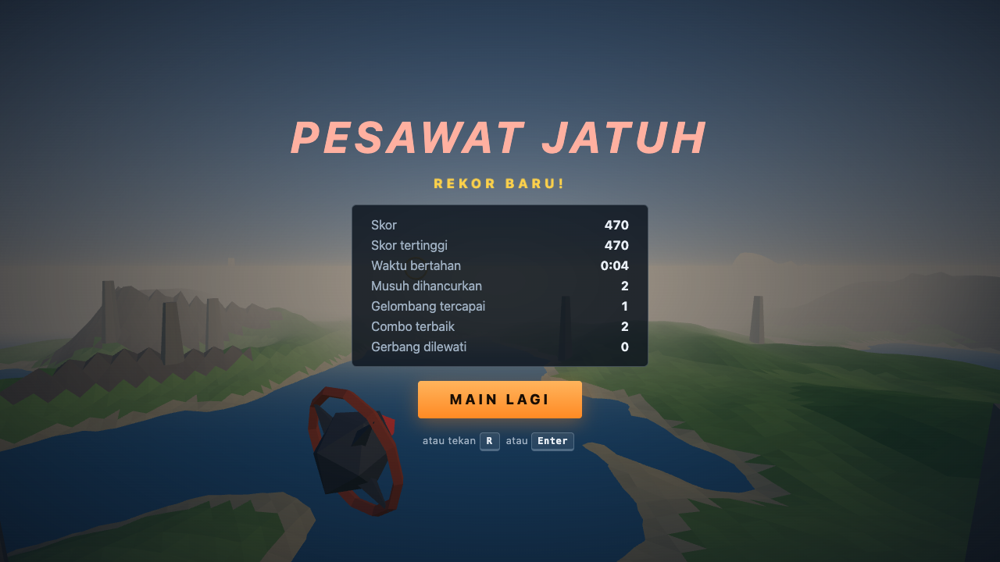

# RAPTOR13

> Superioritas udara dimulai dari sini.

RAPTOR13 adalah game pesawat tempur 3D bergaya arcade yang berjalan langsung di browser.
Seluruh game ada di satu berkas `index.html` (HTML, CSS, dan JavaScript inline), tanpa build step
dan tanpa aset eksternal. Three.js dimuat dari CDN lewat importmap, semua visual dibuat dari
geometri prosedural, dan semua suara disintesis dengan WebAudio.

Nama dan desain pesawat terinspirasi dari konsep jet tempur siluman generasi kelima, tetapi
model pesawatnya orisinal dan bukan replika pesawat nyata mana pun.

| Layar judul | Bermain | Game over |
|---|---|---|
|  |  |  |

## Cara main

Mode permainan adalah bertahan tanpa akhir (endless survival). Pesawat selalu maju sendiri;
tugasmu mengarahkan, menembak, dan bertahan selama mungkin.

- **Musuh datang bergelombang.** Ada dua tipe: *drone* kecil yang mengejar pelan dan meledak
  saat menabrak, serta *pesawat penembak* bersayap delta yang menyerang, melintas, menjauh,
  lalu berbalik dan menembak lagi. Tiap gelombang membawa lebih banyak musuh yang lebih cepat
  dan lebih agresif.
- **Combo.** Hancurkan musuh beruntun dalam 3 detik untuk menaikkan multiplier skor (x1,5, x2,
  sampai x5). Bilah tipis di bawah angka gelombang menunjukkan sisa waktu combo.
- **Gerbang emas** muncul berantai di depan. Terbang melewati tengahnya memberi bonus skor
  dan sedikit isi nitro.
- **Pickup** sesekali muncul dengan sorot cahaya vertikal: hijau untuk perbaikan (+30 integritas),
  oranye untuk nitro (+50 persen meter).
- **Rintangan.** Gunung dan pilar batu di daratan memberi damage besar bila ditabrak. Peringatan
  "TARIK NAIK!" dan bunyi bip muncul saat jalur terbangmu mengarah ke medan.
- Integritas (health) mulai dari 100. Saat mencapai 0 pesawat meledak dan layar ringkasan
  menampilkan skor, skor tertinggi, waktu bertahan, musuh yang dihancurkan, dan statistik lain.
  Skor tertinggi disimpan di `localStorage` browser.
- Panah merah (drone) dan oranye (penembak) di tepi layar menunjukkan arah musuh di luar layar.

## Kontrol

| Tombol | Aksi |
|---|---|
| `W` / `S` | Hidung naik / turun |
| `A` / `D` | Belok kiri / kanan sambil miring |
| `Spasi` (tahan) | Nitro: lebih cepat, FOV melebar, api lebih panjang, menguras meter |
| `Enter` (tahan) | Menembak (dua sayap bergantian) |
| `P` atau `Esc` | Jeda / lanjut |
| `R` | Ulang dari awal |
| `M` | Suara hidup / mati |

Meter nitro pulih pelan setelah dilepas. Bila benar-benar habis, nitro terkunci 2 detik
(bilah berkedip merah) sebelum bisa dipakai lagi. Semua tombol bisa ditekan bersamaan,
misalnya `W` + `D` + `Spasi` + `Enter`.

## Menjalankan secara lokal

Game harus dibuka lewat server statis (bukan `file://`) karena memakai ES module dan importmap.
Tidak perlu `npm install` untuk bermain.

```bash
# pilihan 1: Python bawaan
python3 -m http.server 8080

# pilihan 2: Node (server kecil tanpa dependensi yang ada di repo ini)
npm run serve          # sama dengan: node tests/static-server.mjs 8080
```

Lalu buka `http://localhost:8080/`. Koneksi internet dibutuhkan saat pertama kali memuat
Three.js dari jsDelivr.

### Kualitas grafis

Ada tiga preset di `QUALITY_PRESETS` (bagian atas skrip): `rendah`, `sedang` (bawaan), dan `tinggi`.
Preset mengatur shadow, resolusi shadow map, jumlah partikel, jarak render (jumlah potong
terrain), batas pixel ratio, dan antialiasing. Pilih lewat menu di layar judul atau lewat URL:

```
http://localhost:8080/?kualitas=rendah
```

| Preset | Shadow | Shadow map | Partikel | Jarak pandang | Pixel ratio maks |
|---|---|---|---|---|---|
| rendah | mati | 1024 | 900 | 400 unit | 1 |
| sedang | hidup | 1024 | 1800 | 600 unit | 1,5 |
| tinggi | hidup | 2048 | 3200 | 800 unit | 2 |

## Deploy ke GitHub Pages

Repo ini sudah siap disajikan apa adanya karena tidak ada build step.

1. Buat repo baru bernama `raptor13` di GitHub, lalu dorong isi repo ini:
   ```bash
   git remote add origin https://github.com/<akun-kamu>/raptor13.git
   git push -u origin main
   ```
2. Di GitHub buka **Settings**, lalu **Pages**.
3. Pada **Build and deployment**, pilih **Source: Deploy from a branch**, branch `main`,
   folder `/ (root)`, lalu **Save**.
4. Tunggu satu sampai dua menit. Game tersedia di `https://<akun-kamu>.github.io/raptor13/`.

Folder `node_modules/` tidak ikut ter-commit (ada di `.gitignore`), dan game tidak
membutuhkannya.

## Pengujian otomatis

Uji memakai Playwright (Chromium headless). npm hanya dipakai untuk tooling uji ini.

```bash
npm install
npm test
```

`npm test` otomatis memasang Chromium untuk Playwright (lewat skrip `pretest`), menyalakan
server statis di port 4173, lalu menjalankan seluruh uji di `tests/game.spec.mjs`. Uji
membutuhkan internet untuk memuat Three.js dari CDN.

Setiap uji otomatis gagal bila muncul console error atau warning, error halaman, atau request
ke aset di luar localhost dan Three.js. Cakupannya:

- halaman termuat tanpa error, layar judul dan logo tampil, AudioContext belum dibuat
- klik MULAI memulai game dan membuka audio
- `W`/`S` mengubah pitch dan ketinggian, `A`/`D` membuat belok sambil miring
- `Spasi` menaikkan kecepatan dan menguras nitro, nitro habis memicu kunci
- `Enter` menembak dengan cooldown, kombinasi `W` + `D` + `Spasi` + `Enter` bersamaan
- `Spasi` dan `Enter` memanggil `preventDefault`, blur jendela mereset tombol yang tertahan
- jeda dengan `P` dan `Esc`, ulang dengan `R`, mute dengan `M`
- health 0 memunculkan layar game over, skor tertinggi tersimpan, main lagi bekerja
- skor tertinggi tetap aman saat `localStorage` diblokir
- gerbang, pickup perbaikan, pickup nitro, gelombang musuh, tembakan musuh, combo
- tidak ada kebocoran objek setelah 10 kali restart (objek scene, geometri, shader, listener)
- simulasi 5 menit bermain: sumber daya dan biaya per langkah tetap stabil
- frame rate render nyata (di macOS dengan GPU asli)
- preset kualitas `rendah` dan `tinggi`
- tiga screenshot di `docs/screenshots/` (menu, bermain, game over)

Di macOS Playwright memakai GPU asli lewat ANGLE Metal. Di platform lain memakai SwiftShader
(render perangkat lunak); pesan performa driver GL dari SwiftShader saat mengambil screenshot
diabaikan karena bukan berasal dari game, dan uji frame rate dilewati.

## Struktur proyek

```
raptor13/
├── index.html               # seluruh game: HTML, CSS, dan JavaScript (module)
├── README.md
├── package.json             # hanya untuk tooling uji (Playwright)
├── playwright.config.mjs
├── tests/
│   ├── game.spec.mjs        # suite uji Playwright
│   └── static-server.mjs    # server statis kecil tanpa dependensi
└── docs/screenshots/        # screenshot hasil uji
```

Bagian di dalam skrip `index.html`, berurutan:

| Bagian | Isi |
|---|---|
| CONFIG | semua konstanta gameplay, kualitas, dunia, cahaya, audio |
| UTIL | damping, RNG ber-seed (mulberry32), event bus, uji tabrakan segmen ke bola |
| RENDERER | renderer, scene, kamera, resize |
| GEOMETRI PROSEDURAL | pembangun segitiga flat-shaded, loft badan pesawat, pelat sayap |
| PESAWAT PEMAIN | model prosedural, fisika arcade, nitro, damage |
| NOISE dan DUNIA | simplex noise 2D, terrain ber-potong yang di-recycle, laut, langit, matahari, fog, cahaya |
| PELURU dan SENJATA | pool `InstancedMesh`, cooldown, konvergensi, aim assist |
| MUSUH dan GELOMBANG | dua tipe musuh, AI, spawn bergelombang, tembakan musuh |
| TABRAKAN | peluru, badan musuh, terrain, pilar |
| RINTANGAN, CINCIN, PICKUP, COMBO | objek dunia dan sistem skor |
| PARTIKEL | dua sistem `Points` dengan shader sendiri |
| KAMERA CHASE | lag rotasi, FOV nitro, camera shake |
| AUDIO | sintesis WebAudio |
| HUD | elemen DOM, skor tertinggi, indikator musuh |
| GAME STATE dan INPUT | state machine, keyboard |
| HOOK DEBUG dan MAIN LOOP | `window.__game`, `requestAnimationFrame`, dispose |

## Mengatur gameplay (tuning)

Semua angka yang memengaruhi permainan ada di objek `CONFIG` di bagian atas skrip, misalnya:

- `CONFIG.player`: kecepatan dasar dan nitro, batas pitch dan roll, laju belok, batas ketinggian
- `CONFIG.nitro`: laju kuras, laju pulih, jeda pulih, lama kunci
- `CONFIG.weapons`: cooldown, kecepatan peluru, damage, sudut aim assist (0 untuk mematikan)
- `CONFIG.enemies`: ukuran pool, HP, kecepatan, damage, jangkauan dan laju tembak
- `CONFIG.waves`: jeda antar gelombang, laju spawn, kenaikan kesulitan
- `CONFIG.combo`, `CONFIG.rings`, `CONFIG.pickups`, `CONFIG.obstacles`
- `CONFIG.camera`, `CONFIG.sky`, `CONFIG.light`, `CONFIG.audio`, `CONFIG.world`

## Hook debug

`window.__game` tersedia untuk uji otomatis dan eksperimen di console browser:

```js
__game.snapshot()                   // state ringkas: skor, health, posisi, nitro, jumlah musuh, fps
__game.setSeed(42)                  // kunci seed dunia dan gameplay untuk sesi berikutnya
__game.start(); __game.restart(); __game.pause(); __game.resume()
__game.quality()                    // preset kualitas yang aktif
__game.debug.setGod(true)           // kebal damage
__game.debug.setEnemiesEnabled(false)
__game.debug.spawnEnemy('drone', 200, 0)
__game.debug.placeRingAhead(120)
__game.debug.placePickupAhead('repair', 120)
__game.debug.simulate(300)          // simulasi cepat 5 menit dengan pengendali otomatis
__game.debug.resources()            // jumlah objek scene, geometri, shader, listener
```

## Keputusan desain

- **Fisika arcade berbasis target sudut.** Input mengatur target pitch dan roll yang didekati
  dengan damping eksponensial (tidak bergantung frame rate). Laju belok sebanding dengan
  kemiringan sayap sehingga bank dan belok selalu selaras. Pitch dan roll dibatasi sehingga
  pesawat tidak bisa terbalik.
- **Kamera dengan lag rotasi, bukan lag posisi.** Jarak kamera ke pesawat tetap stabil pada
  kecepatan berapa pun, sementara arah kamera menyusul dengan halus. Getar kamera memakai
  kombinasi sinus agar lebih halus daripada jitter acak.
- **Terrain toroidal.** Dunia terdiri dari N x N potong terrain. Slot (i, j) selalu memegang
  potong yang koordinatnya modulo N sama dengan (i, j), sehingga saat pemain bergerak hanya
  baris di tepi yang dibangun ulang, dengan batas beberapa potong per frame. Geometri dibuat
  sekali dan hanya isi buffer-nya yang ditulis ulang. Ketinggian untuk tabrakan dihitung dari
  segitiga yang sama persis dengan mesh.
- **Tanpa alokasi di jalur panas.** Peluru, partikel, musuh, cincin, dan pickup memakai pool
  berukuran tetap. Vektor sementara dipakai ulang, HUD hanya menulis ke DOM saat nilainya
  berubah, dan restart hanya me-reset pool yang sama.
- **Event bus.** Efek partikel, suara, dan HUD mendaftar ke event sekali saat inisialisasi,
  sehingga restart tidak pernah menumpuk listener.
- **Warna fog sama dengan horizon langit.** Shader langit menulis nilai sRGB mentah yang sama
  dengan warna fog yang dikirim three.js ke shader, sehingga terrain menyatu mulus ke langit.
- **Shadow murah.** Hanya pesawat (pemain dan musuh) yang cast shadow, ke frustum kecil
  (120 unit) yang mengikuti pemain. Terrain dan laut hanya menerima shadow. Jumlah lampu
  tidak pernah berubah (lampu nitro hanya diatur intensitasnya) agar shader tidak dikompilasi ulang.
- **Random ber-seed untuk gameplay, `Math.random` untuk kosmetik.** Jumlah partikel bergantung
  frame rate, jadi partikel tidak memakai RNG gameplay agar urutan random permainan tetap konsisten.
- **AudioContext hanya dibuat saat ada aktivasi pengguna yang sah** (dicek lewat
  `navigator.userActivation`), sehingga browser tidak mencetak peringatan autoplay.

## Keterbatasan yang diketahui

- Hanya kontrol keyboard; belum ada dukungan mouse, gamepad, atau layar sentuh.
- Three.js dimuat dari CDN, jadi permainan pertama kali butuh internet.
- Musuh tidak menghindari pilar batu; mereka hanya menjaga jarak dari permukaan terrain.
- Tabrakan memakai bola dan jarak kuadrat, jadi bentuk sayap tidak dihitung secara presisi.
- Uji frame rate hanya berjalan di macOS dengan GPU asli; di platform lain uji memakai
  render perangkat lunak yang jauh lebih lambat.
- Layout HUD dirancang untuk layar desktop dan laptop; layar sangat sempit akan terasa padat.

## Ide lanjutan

Fitur berikut **sudah ditambahkan** di luar spesifikasi awal, dicatat di sini sesuai aturan proyek:

- Aim assist kecil (kerucut 5 derajat, bisa dimatikan lewat `CONFIG.weapons.aimAssistAngle`).
- Pemilih kualitas di layar judul (memuat ulang dengan `?kualitas=`).
- Peringatan medan "TARIK NAIK!" dengan bunyi bip.
- Musuh yang tertinggal lama di belakang pemain dipindah lagi ke depan.
- Asap hitam dari pesawat saat integritas rendah, vignette merah saat terkena tembakan.
- Seed dunia acak di setiap sesi, latar layar judul berupa pesawat yang terbang otomatis.

Ide yang **belum** dikerjakan:

- Dukungan gamepad dan layar sentuh.
- Tipe musuh ketiga (misalnya bomber besar dengan beberapa titik lemah).
- Misil pengunci target dengan cooldown panjang.
- Siklus waktu (senja, malam) dan cuaca.
- Papan skor lokal berisi beberapa skor terbaik.
