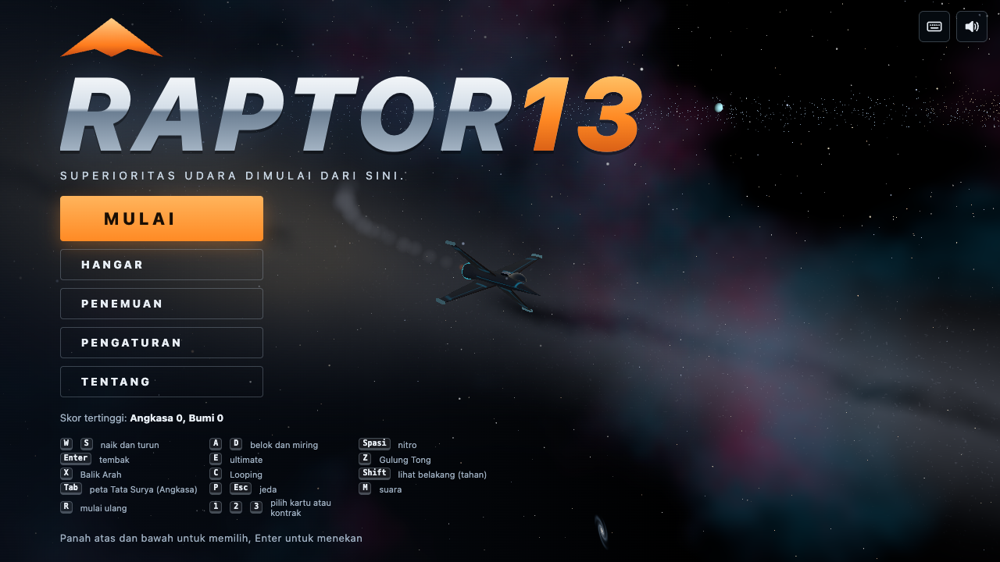
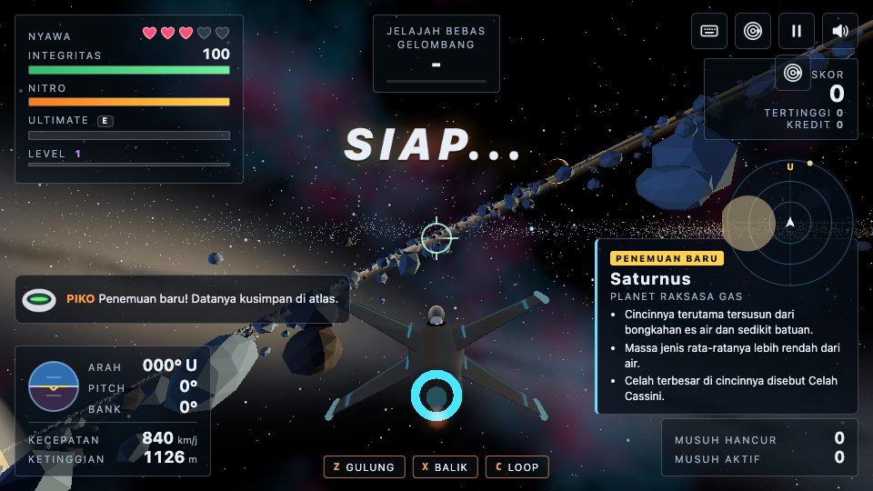
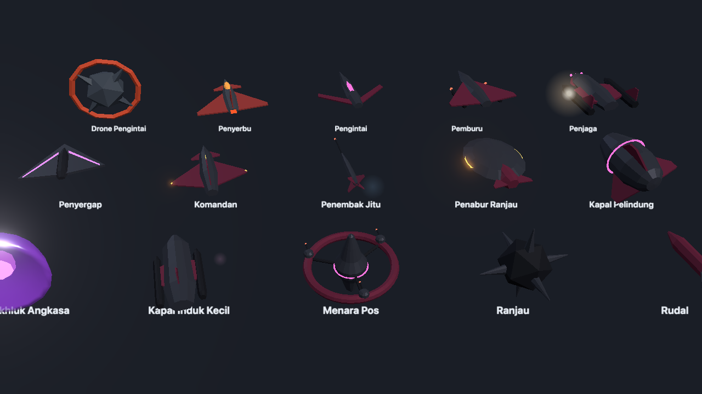
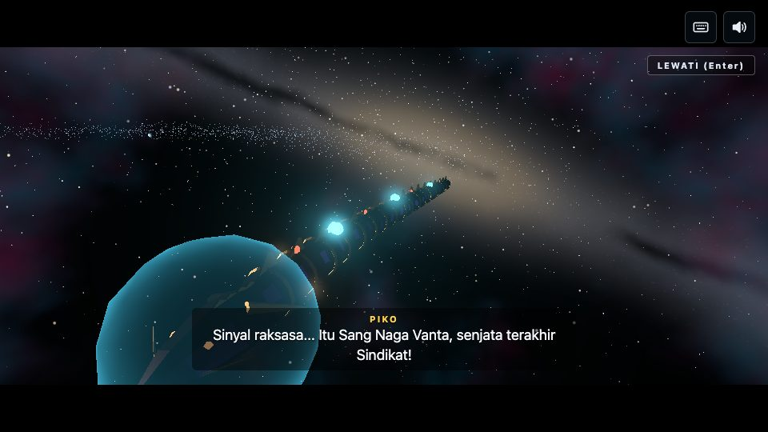
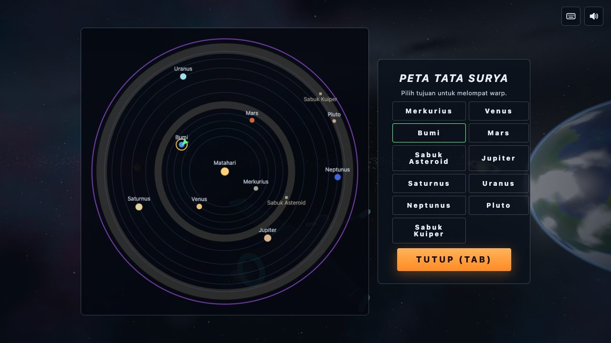
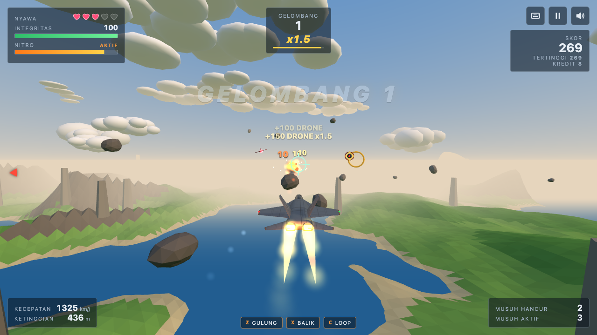
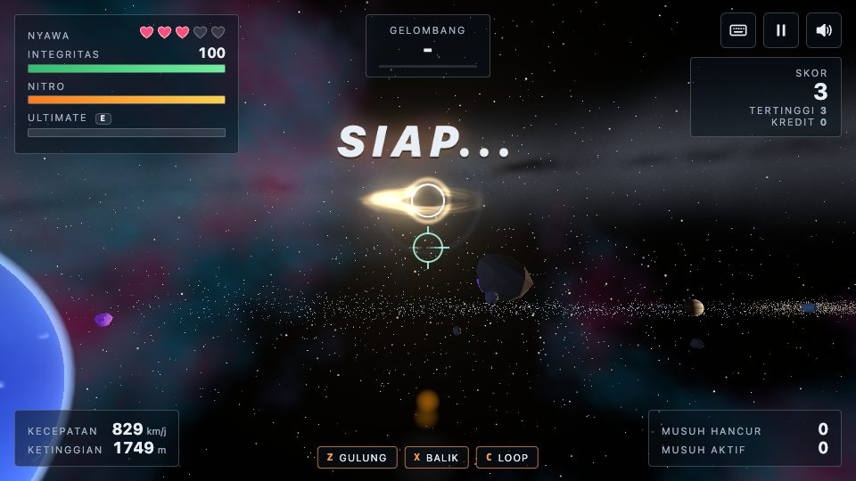
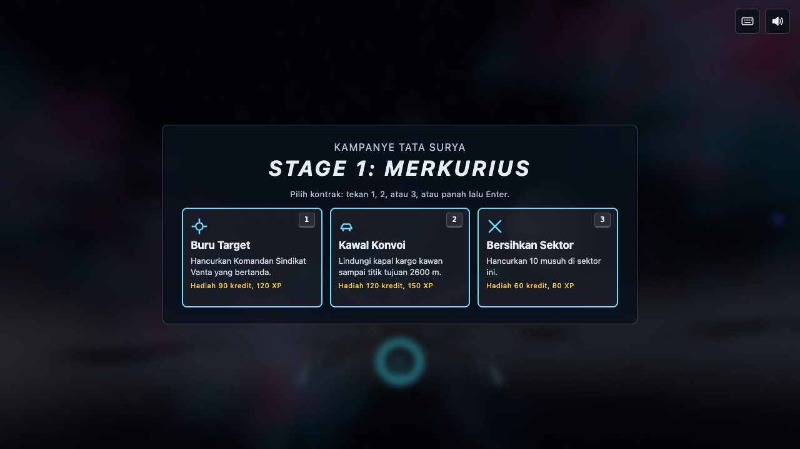
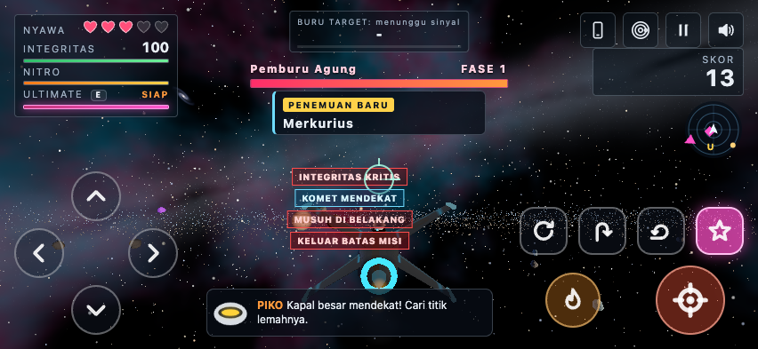

# RAPTOR13

> Superioritas udara dimulai dari sini.

RAPTOR13 adalah game tempur udara dan angkasa 3D bergaya arcade yang berjalan langsung di browser.
Seluruh game ada di satu berkas `index.html` (HTML, CSS, dan JavaScript inline), tanpa build step
dan tanpa aset eksternal. Three.js 0.187.0 ditanam lokal di `vendor/three-0.187.0/` (berkas resmi npm,
dipetakan importmap dengan integrity sha384), semua model, tekstur, langit, dan planet dibuat prosedural
oleh kode, dan semua suara serta musik disintesis dengan WebAudio.

Versi saat ini: **2.3.1** (lihat [CHANGELOG.md](CHANGELOG.md)). Tanpa cookie, pelacak, atau analitik.

### Yang baru di 2.3.1

- **Bug zoom iPhone diperbaiki.** Game tidak lagi menyusut ke kiri atas saat iOS memperbesar halaman. Semua
  ukuran kini berasal dari layout viewport. Overlay `?diag=1` menampilkan angka zoom untuk laporan uji.
- **Hitbox sesuai bentuk.** Bos, asteroid, komet, musuh, dan bulan tak bulat memakai bentuk tabrakan dari
  geometri. Peringatan **BELOK SEKARANG** dan tepi layar merah muncul bila benda fatal ada di jalur.
- **Penanda bos lebih rapi.** Di dekat crosshair penanda menjadi braket tipis yang tidak menutupi bos atau
  titik bidik. Bos sangat jauh selalu diberi titik 16 piksel bercincin gelap.
- **Pertarungan bos disetel** dengan bot terampil: di Normal sekitar 1,5 sampai 2,2 menit per bos reguler.
- Skrip deploy aman, dokumen verifikasi developer Android, dan keputusan Capacitor atau TWA untuk APK.

Ada dua medan: **Luar Angkasa** (Tata Surya lengkap dengan Kampanye 10 stage dan Jelajah Bebas)
dan **Atmosfer Bumi** (gelombang tanpa akhir di atas pegunungan, laut, dan pilar batu).

Repo: <https://github.com/ahmadngiliyun00/raptor13>

| Menu | Cincin Saturnus | Galeri musuh |
| --- | --- | --- |
|  |  |  |
| **Sang Naga Vanta** | **Peta Tata Surya** | **Medan Bumi** |
|  |  |  |
| **Black hole dari Tata Surya luar** | **Pilih kontrak** | **Kontrol HP** |
|  |  |  |

## Menjalankan

Game harus dibuka lewat server statis (bukan `file://`) karena memakai ES module dan importmap.
Tidak perlu `npm install` untuk bermain.

```bash
python3 -m http.server 8080      # atau: npm run serve
```

Lalu buka `http://localhost:8080/`. Tidak butuh internet: Three.js ada di `vendor/`.

Header keamanan server, contoh `.htaccess` untuk OpenLiteSpeed atau CyberPanel, padanan nginx, dan
perintah verifikasi `curl -I` ada di [docs/deploy/security-headers.md](docs/deploy/security-headers.md).

### Deploy ke GitHub Pages

Repo sudah publik dan tidak butuh build. Di GitHub buka **Settings**, **Pages**, pilih
**Deploy from a branch**, cabang `main`, folder `/ (root)`, lalu simpan. Setelah satu sampai dua
menit game tersedia di `https://ahmadngiliyun00.github.io/raptor13/`.

## Kontrol

| Tombol | Aksi |
| --- | --- |
| `W` `S` | naik dan turun (menahan terus menghasilkan looping penuh) |
| `A` `D` | belok dan miring |
| `Spasi` | nitro |
| `Enter` | tembak |
| `E` | ultimate laser |
| `Z` | Gulung Tong (kebal peluru selama gulungan; juga ketuk ganda `A` atau `D`) |
| `X` | Balik Arah (setengah looping lalu setengah gulungan) |
| `C` | Looping |
| `Shift` (tahan) | lihat belakang |
| `Tab` | peta Tata Surya (medan Angkasa) |
| `P` atau `Esc` | jeda |
| `M` | suara |
| `R` | mulai ulang |
| `1` `2` `3` | pilih kartu level atau kontrak |

Pemetaan yang sama tampil di layar judul dan di Pengaturan. Di perangkat sentuh dipakai mode HP,
lihat bagian berikut.

## Mode HP (layar sentuh, landscape)

HP murni (pointer kasar tanpa hover) langsung memakai mode HP tanpa pop-up. Perangkat yang ambigu,
misalnya laptop layar sentuh, mendapat saran kecil di tengah atas. Mode bisa diganti kapan saja
lewat tombol kanan atas di menu, Pengaturan, atau menu jeda. Di perangkat sentuh tanpa save,
kualitas bawaan Rendah, bloom mati, dan Bantuan robot Ringkas.

**Kontrol.** Semua ukuran diturunkan dari satuan `--u = clamp(34px, 11vh, 48px)` yang dihitung dari
tinggi tampak (`visualViewport`), sehingga ikut menyesuaikan saat bar browser muncul atau hilang.

| Kontrol | Ukuran | Keterangan |
| --- | --- | --- |
| Joystick analog melayang | dasar 2,6u, jempol 1,1u | muncul di titik sentuh pertama pada 45 persen kiri layar; atas naik, kiri belok kiri; deadzone 12 persen dan kurva halus |
| Tembak | 1,4u | pojok kanan bawah, tahan untuk menembak |
| Nitro | 1,1u | tepat di atas Tembak |
| Gulung, Balik, Loop, Ultimate | 1,0u | grid 2x2 di kiri Tembak |

Ukuran tampak boleh kecil, tetapi area sentuh efektif selalu minimal 44 px lewat hit slop
transparan, dan jarak antar tombol dihitung agar hit slop tidak saling menimpa. Multi-touch bekerja
(joystick, tembak, dan nitro bersamaan). Tombol samar saat diam dan lebih jelas saat ditekan.
Skala kontrol dibatasi otomatis agar tiap cluster maksimal 30 persen tinggi dan 26 persen lebar
layar dan tetap di luar zona tengah.

**HUD ringkas.** Kiri atas satu blok 146x47 px (hati, LV, bar HP, bar nitro dan ultimate tipis
berikon). Tengah atas satu baris misi dengan progres, pengali kombo, dan skor; bar bos 5 px muncul
di bawahnya saat bos aktif. Kanan atas hanya Jeda dan Suara, radar 52 px di bawahnya dengan ikon
peta di sampingnya. Mode kontrol, Peta, dan Layar penuh ada di menu jeda. Teks minimal 11 px.

**Satu notifikasi.** Ucapan Piko, nama area, pickup, level, dan kontrak masuk satu antrean
berprioritas. Hanya satu toast tampil, tepat di bawah baris misi dan tidak pernah melewati 20 persen
tinggi layar. Pesan yang menunggu lebih dari 4 detik dibuang, prioritas lebih tinggi menyela.
Peringatan kritis (tarik naik, HP kritis, musuh di belakang, komet) berupa chip ikon berkedip di
tepi bawah, teks maksimal tiga kata.

**Kamera.** Di layar landscape pendek kamera chase 20 persen lebih jauh dengan titik pandang sedikit
naik, sehingga pesawat sekitar 18 persen tinggi layar di sepertiga bawah tengah.

**Layar lain.** Menu dua kolom, jeda dua kolom, Pengaturan bertab (Umum, Suara, Kontrol, Grafis,
Lainnya), kartu kontrak dan level tiga kolom, peta berdampingan; semuanya muat di tinggi 320 px tanpa
scroll. HUD, kontrol, dan toast disembunyikan di balik layar overlay. Tidak ada teks petunjuk
keyboard di mode HP.

**Layar penuh dan orientasi.** Tombol Layar penuh di menu jeda dan tip pertama di menu memakai
Fullscreen API lalu mencoba mengunci landscape. Di iPhone (tanpa Fullscreen API) muncul sekali
petunjuk Tambahkan ke Layar Utama. Saat tegak, permainan dijeda dengan overlay Putar ke landscape
yang tidak menutupi toolbar.

| Opsi baru di Pengaturan | Nilai |
| --- | --- |
| Gaya kontrol kiri | Joystick (bawaan) atau Tombol arah (cakram tetap dengan arah diagonal) |
| Ukuran kontrol | 70 sampai 130 persen (dibatasi anggaran layar; label menunjukkan nilai efektif) |
| Transparansi kontrol | 0 sampai 80 persen |
| Mode kidal | joystick di kanan, tombol aksi di kiri |
| Jarak kamera | Dekat, Normal, Jauh |
| Bantuan robot | Penuh, Ringkas, Hanya ikon, Mati |

**Menguji HP berponi tanpa perangkat.** Tambahkan `?safearea=kiri,atas,kanan,bawah` dalam px,
misalnya `index.html?safearea=47,0,47,21`. Semua jarak tepi memakai `max(safe area, 8px)` (tidak
dijumlahkan dengan 16 px), jadi contoh itu menghasilkan tepi 47, 8, 47, dan 21 px.

Hasil ukur akhir (emulasi sentuh, saat bermain tanpa notifikasi):

| Layar | Luas HUD dan kontrol | --u | Tembak, nitro, tombol kecil, joystick (px) | Cluster aksi | Pesawat |
| --- | --- | --- | --- | --- | --- |
| 568x320 | 19,3% | 35 | 49, 39, 35, 92 | 135x92 (24% x 29%) | 18% di 68% tinggi |
| 568x320 berponi 47/47 | 15,5% | 35 | 39, 31, 28, 72 (dikecilkan otomatis) | 123x80 (22% x 25%) | 18% |
| 667x375 | 16,6% | 41 | 58, 45, 41, 107 | 148x107 (22% x 29%) | 18% |
| 740x360 | 14,9% | 40 | 55, 44, 40, 103 | 144x103 (19% x 29%) | 18% |
| 812x375 | 13,7% | 41 | 58, 45, 41, 107 | 148x107 (18% x 29%) | 18% |
| 844x390 | 13,2% | 43 | 60, 47, 43, 112 | 154x111 (18% x 29%) | 18% |
| 915x412 | 12,3% | 45 | 63, 50, 45, 118 | 162x117 (18% x 28%) | 18% |
| 932x430 | 12,2% | 47 | 66, 52, 47, 123 | 169x122 (18% x 28%) | 18% |

Blok status 146x47 px, baris misi 184x24 px (166 px saat berponi), radar 52 px di semua ukuran.

## Cara main

**Kampanye Tata Surya** (bawaan medan Angkasa) berisi 10 stage berurutan: Merkurius, Venus,
Bumi dan Bulan, Mars, Sabuk Asteroid, Jupiter, Saturnus, Uranus, Neptunus, serta Pluto dan
Sabuk Kuiper. Setiap stage:

1. Pembuka singkat (sekali per stage): kamera menyapu planet sambil pilot berkode panggil
   **Raptor 13** dan robot pendamping **Piko** bercakap.
2. Kartu stage lalu **pilih kontrak**: *Buru Target* (hancurkan Komandan bertanda),
   *Kawal Konvoi* (lindungi kapal kargo kawan sampai suar tujuan; kargo hancur berarti game over),
   atau *Bersihkan Sektor* (hancurkan sejumlah musuh).
3. Gelombang musuh berjalan sampai kontrak selesai. Stage 5 dan 8 punya mini-boss, stage 10
   punya final boss.
4. Layar **Stage Clear**: skor, waktu, musuh, HP hilang, bonus, dan rating 1 sampai 3 bintang
   (disimpan). LANJUT membuka **gerbang loncat**; terbang menembusnya untuk warp ke stage berikutnya.

**Jelajah Bebas**: seluruh Tata Surya terbuka dengan gelombang tanpa akhir. Buka peta dengan `Tab`
lalu pilih tujuan untuk lompatan warp sinematik.

**Medan Bumi**: gelombang tanpa akhir, cincin untuk diterbangi, asteroid melayang yang pecah,
pilar batu tinggi, dan bos Penjaga Raksasa setiap 5 gelombang.

Sistem lain:

- **Nyawa dan integritas**: hati di HUD, kebal sebentar setelah respawn. Menabrak tanah, laut,
  gunung, pilar, planet, bulan, Matahari, stasiun, bos, atau asteroid raksasa langsung game over
  (bisa dimatikan lewat opsi *Tabrakan fatal* untuk latihan).
- **Bintang** berwarna: merah mengisi ultimate, hijau HP, biru nitro, emas XP dan skor, ungu nyawa.
  Bintang tertarik magnet ke kapal.
- **Ultimate laser** (`E`): sinar 2,5 detik yang merusak semua yang dilewati.
- **XP dan level**: naik level menjeda permainan dan menawarkan 3 kartu upgrade berkelangkaan
  (biasa, langka, epik): damage, laju tembak, HP maksimum, nitro, magnet, ultimate, perisai energi,
  drone pendamping (maksimal dua), kartu Piko, nyawa, dan Inti Overdrive.
- **Kredit** dari musuh dan asteroid; 50 persen dibawa pulang saat game over, penuh saat keluar
  dari Stage Clear atau menamatkan kampanye. Kredit membuka kapal di **Hangar**.
- **Penemuan**: mendekati planet, bulan, atau sabuk memunculkan panel data berisi fakta dunia
  nyata; semua yang pernah didekati tersimpan di atlas **PENEMUAN** di menu.

## Simpan dan muat

Semua data disimpan di perangkat pemain lewat `localStorage` browser, tanpa server dan tanpa akun:

| Kunci | Isi | Kapan ditulis |
| --- | --- | --- |
| `raptor13.v3` | profil permanen: pengaturan, skor tertinggi, kredit, kapal terbuka, progres dan rating kampanye, atlas Penemuan | setiap kali berubah |
| `raptor13.session.v1` | sesi yang sedang dimainkan: medan, stage dan kontrak, skor, waktu, nyawa, integritas, nitro, ultimate, level dan kartu, gelombang, posisi di angkasa | otomatis tiap 10 detik, saat jeda, saat ke menu, saat tab disembunyikan atau halaman ditutup, dan lewat tombol **SIMPAN** di menu jeda |

Setelah halaman dimuat ulang, menu menampilkan **LANJUTKAN** beserta ringkasan simpanan. Sesi
dimuat lalu dilanjutkan dengan hitung mundur. Di medan Bumi kapal kembali ke titik aman (statistik
tetap), di medan Angkasa posisi dan arah kapal dipulihkan. Simpanan sesi dihapus saat game over,
saat menamatkan kampanye, dan saat keluar dari layar Stage Clear. MULAI saat ada simpanan meminta
konfirmasi dulu. Data rusak diabaikan dengan aman.

Semua akses penyimpanan sesi lewat adaptor `Store` (get, set, remove). Bila game nanti dibungkus
menjadi aplikasi Android, `localStorage` tetap bekerja di dalam WebView aplikasi; bila ingin
penyimpanan native yang lebih tahan terhadap pembersihan data, cukup adaptor itu yang diganti.

## Kapal

| Kapal | Medan | Segitiga | Keterangan |
| --- | --- | --- | --- |
| Raptor-J | Bumi | 4.520 | jet loft superellipse dengan sayap airfoil NACA, kanopi lathe, angka 13 di sirip |
| Starfighter | Angkasa | 3.724 | empat bilah sayap konfigurasi X yang bergerak dinamis, thruster manuver, soket Piko |
| Interceptor | Angkasa | sekitar 3.700 | varian lebih cepat dan lincah, 500 kredit |
| Gunship | Angkasa | 4.036 | varian berat ber-HP tebal, 1200 kredit |
| Piko | robot | 852 | ekspresi mata di kanvas, bip sintesis, panel subtitle berbatas frekuensi |

Pratinjau: `?jetpreview=1`, `?shippreview=starfighter` (juga `jet`, `interceptor`, `gunship`, `piko`),
dan `?gallery=1` untuk galeri seluruh musuh.

## Tata Surya

Matahari bergranulasi, delapan planet, Pluto, dan bulan utama (Bulan, Phobos, Deimos, Io, Europa,
Ganymede, Callisto, Titan, Charon). **Jarak dan ukuran dipadatkan, bukan skala asli**: Merkurius
berada 3.200 unit dari pusat Matahari dan Pluto 37.000 unit agar antar planet tetap bisa diterbangi.
Urutan ukuran tetap masuk akal (Matahari, Jupiter, Saturnus, Uranus, Neptunus, Bumi, Venus, Mars,
Merkurius, Pluto). Fakta di panel data adalah fakta dunia nyata.

- Tekstur kanvas dari noise 3D yang disampel di permukaan bola (tanpa sambungan): kawah dengan peta
  tinggi untuk bump, pita awan dan Bintik Merah Besar Jupiter, dataran berbentuk hati di Pluto,
  lampu kota di sisi malam Bumi, awan yang berputar, atmosfer di tepi siluet.
- Satu shader planet menghitung cahaya dari posisi Matahari yang sebenarnya, jadi sisi terang
  selalu menghadap Matahari; kapal juga meredup saat berada di bayangan planet.
- Cincin Saturnus dengan Celah Cassini, bayangan planet di cincin, dan ribuan batu es instanced;
  cincin tipis Jupiter dan Uranus. Sabuk Asteroid dan Sabuk Kuiper dibangkitkan per sel di sekitar
  kamera. Batu terdekat diganti asteroid sungguhan yang punya HP dan bisa pecah (LOD).
- Latar pita Bima Sakti dengan jalur debu, galaksi spiral jauh, dan black hole dengan piringan
  akresi dan cincin cahaya terbelokkan yang hanya terlihat dari Tata Surya luar.
- Benda jauh digambar sebagai **proksi berskala** (didekatkan ke kamera dan diperkecil sebanding)
  sehingga ukuran sudutnya benar tanpa logarithmic depth buffer.
- Dinding energi bergrid di radius 45.000 dengan peringatan KELUAR BATAS MISI dan dorongan balik.

## Musuh dan bos

Faksi fiktif **Sindikat Vanta**: lambung gelap dengan aksen emissive merah, magenta, atau ungu.
Semua model dari loft, lathe, dan pelat.

| Musuh | Perilaku |
| --- | --- |
| Drone Pengintai | kecil, menabrak; membelok menjauh setelah lewat |
| Pengintai | cepat, tembakan tunggal lemah, datang berformasi V |
| Penyerbu | rentetan 3 peluru, mengejar lalu menyamping |
| Pemburu | rudal lambat yang mengejar dan bisa ditembak jatuh |
| Penjaga | berat, tembakan menyebar 5 peluru |
| Penyergap | menyamar saat mendekat, menyergap dari belakang |
| Komandan | berperisai pulih, dikawal dua Penyerbu, target kontrak buruan |
| Penembak Jitu | menjaga jarak, garis bidik merah 1 detik sebelum menembak |
| Penabur Ranjau | menyilang di depan dan menjatuhkan ranjau yang berkedip lalu meledak |
| Kapal Pelindung | perisai yang pulih setelah jeda |
| Makhluk Angkasa | ubur-ubur bertentakel yang menyengat dari dekat |
| Kapal Induk Kecil | meluncurkan drone berkala |
| Menara Pos | stasiun diam dengan tiga turret bertanda lampu |

Semua tembakan musuh bertanda (kilat moncong, lampu, atau garis bidik sekitar setengah detik),
berwarna magenta yang berbeda dari peluru pemain, dan cukup lambat untuk dihindari.

Bos: **Penjaga Raksasa** (Bumi, tiap 5 gelombang), **Penambang Raksasa** (stage 5: bor yang
berputar sebagai tanda lalu menyerbu, lengan pelempar batu), **Pemburu Agung** (stage 8: cepat,
fase kedua memanggil tiga umpan tiruan), dan **Sang Naga Vanta** (stage 10): naga mekanik
bersegmen dengan empat fase (generator perisai, kepala terbuka dengan laser bergaris peringatan,
kejar-kejaran 50 detik melewati puing es, dan inti dada yang hanya bisa dihabisi ultimate), dengan
cutscene pembuka, peralihan, dan penutup, lalu layar akhir.

### Pelacakan dan perilaku bos (2.3.0)

**Penanda dan arah.**

- Tiap bos punya ikon emblem orisinal. Ikon tampil di bar bos dan baris misi ("BOS: nama"), di atas bos
  (braket sudut, nama, jarak, bar HP mini, panah arah gerak), dan di panah tepi layar saat bos di luar
  layar.
- Saat bos di belakang, panah tepi menunjuk arah putar tercepat, dan muncul indikator BOS DI BELAKANG di
  bawah tengah.
- Bos meninggalkan jejak 3 detik. Titik bidik prediksi (ikut Bantuan bidik) menunjukkan tempat peluru akan
  mengenai bos.
- Di radar, bos tampil sebagai ikon dengan jejak mini dan garis putus-putus. Di Peta Tata Surya bos juga
  ditandai ikon.

**Keterlihatan.**

- Bos diberi rim light berwarna khas dan kontur siluet menyala (satu draw call). Opsi Sorotan bos: Mati,
  Halus, Kuat.
- Bos yang lebih kecil dari 14 piksel diberi titik 16 piksel bercincin gelap (2.3.1), di semua dunia,
  kualitas, dan jarak. Dari 576 kombinasi yang diukur, 0 tidak terlihat.
- Bos tidak lagi tertelan kabut Bumi atau terpotong bidang jauh kamera.
- Penanda ringkas (2.3.1): di zona tengah dan dekat crosshair penanda hanya berupa braket tipis dan HP kecil,
  tiap sudutnya minimal 30 piksel dari crosshair. Bos lebih besar dari 120 piksel hanya diberi bar HP tipis.

**Perilaku.** Siklus bos: mendekat lalu terbang di depan pemain, serang lewat depan, lewat dan menjauh, lalu
berputar menyusul ke depan lagi. Saat kembali ke depan ada jendela rentan berkedip emas, dengan damage ke bos
x1,6, x1,4, atau x1,25.

| Kesulitan | Waktu bos di kerucut depan (bot jelajah) | Batas di ekor |
| --- | --- | --- |
| Mudah | sekitar 69 persen | 4 detik |
| Normal | sekitar 46 persen | 6 detik |
| Sulit | sekitar 26 persen | 9 detik |

Sebelumnya bos 1 sampai 3 persen di depan. Rincian: [docs/bos/diagnosis.md](docs/bos/diagnosis.md) dan
[docs/bos/perilaku.md](docs/bos/perilaku.md).

**Lama pertarungan (2.3.1).** Diukur dengan bot terampil yang memakai batasan kapal pemain, tundaan reaksi
250 ms, dan galat bidik. Median detik sampai bos kalah:

| Bos | Mudah | Normal | Sulit |
| --- | --- | --- | --- |
| Penjaga Raksasa | 53 | 93 | 175 |
| Penambang Raksasa | 102 | 133 | 233 |
| Pemburu Agung | 36 | 110 | 257 |
| Sang Naga Vanta | tidak kalah dalam 600 | tidak kalah dalam 600 | tidak kalah dalam 600 |

Sang Naga Vanta belum terkalahkan bot karena generator perisainya sangat kecil dari jarak tempur; ini butuh
keputusan desain (lihat `docs/bos/perilaku.md`). Sepuluh pertarungan bos terakhir disimpan di perangkat dan ikut
dalam log `?diag=1`.

## Tabrakan (2.3.0)

Tabrakan dihitung dari ukuran dan energi (`COLLISION_TIERS`):

- **Fatal:** planet, bulan, daratan, pilar, bos, kapal berat, asteroid minimal sekitar R 18, atau benturan
  berenergi ekstrem.
- **Sedang:** benda lain memotong persen HP maksimum yang naik dengan energi, misalnya 8 persen untuk
  asteroid kecil, 19 persen untuk yang sedang, dan 39 persen untuk yang besar pada kecepatan dasar. Damage
  dikali kesulitan, dan pesawat memantul.
- **Pantul:** puing yang jauh lebih kecil dari pesawat hanya 1 sampai 3 persen.
- **Kecil:** kerikil tidak memberi damage.

Satu benda tidak dihitung dua kali, dan uji sapuan mencegah tembus pada kecepatan tinggi. Tabel lengkap:
[docs/fisika/tabrakan.md](docs/fisika/tabrakan.md).

Sejak 2.3.1 bentuk tabrakan mengikuti bentuk yang terlihat: bos memakai beberapa bola padat yang dibuat dari
geometrinya, dan ambang fatal dihitung relatif terhadap ukuran visual kapal. Bila benda fatal ada di jalur,
muncul peringatan **BELOK SEKARANG**, tepi layar merah ke arah benda, dan asteroidnya diberi rona merah. Audit
dan wireframe: [docs/fisika/audit-hitbox.md](docs/fisika/audit-hitbox.md).

## HUD

Status di kiri atas (nyawa, integritas, nitro, ultimate, level dan XP), misi dan gelombang di
tengah atas, skor dan kredit di kanan atas, **radar minimap** yang berputar mengikuti arah kapal
(musuh, bos, pickup, planet, gerbang, kargo, target kontrak, panah tujuan misi), **instrumen terbang**
(horizon buatan, arah kompas dalam derajat, pitch, dan bank yang bernilai 0 saat datar), bar HP bos,
angka skor emas dan angka damage merah yang besar, serta panel Piko bersubtitle. Di mode HP dipakai
HUD ringkas dan satu pusat notifikasi (lihat Mode HP).

## Kualitas grafis

Pilih di Pengaturan atau lewat URL `?kualitas=rendah|sedang|tinggi` (`QUALITY_PRESETS`).

| Preset | Shadow | Partikel | Bloom | Tekstur planet | Kepadatan batu | Jarak muat |
| --- | --- | --- | --- | --- | --- | --- |
| rendah | mati | 900 | mati | 512 | 0,45 | 0,75 |
| sedang | hidup | 1800 | sebagian | 512 | 0,8 | 0,9 |
| tinggi | hidup | 3200 | penuh | 1024 | 1 | 1 |

### Mode performa dan panas (2.2.0)

Pengaturan, tab Grafis dan Lainnya:

| Opsi | Nilai | Isi |
| --- | --- | --- |
| Mode performa | Otomatis (bawaan), Hemat baterai, Seimbang, Kualitas tinggi | Otomatis memakai resolusi dinamis dan menurunkan satu tingkat (bloom, lalu bayangan dan partikel, di HP juga 45 lalu 30 FPS) bila tetap lambat, serta berperilaku hemat saat baterai lemah. Hemat baterai: 30 FPS, tanpa bloom dan bayangan, partikel 50 persen, resolusi 0,75 |
| Batas FPS | Otomatis (60), 30, 60, Tanpa batas | Menu 20 FPS, layar statis tidak dirender ulang |
| Resolusi maksimum | Otomatis, 1x, 1,5x, 2x | Otomatis mengikuti kualitas, maksimal 1,25 di perangkat sentuh, maksimal 2 juta piksel di Rendah dan Sedang |
| Overlay performa | F3 | FPS, frame time, draw call, segitiga, resolusi, mode |

Hasil ukur di MacBook Pro M1 Pro (ANGLE Metal): tanpa batas frame menu dulu butuh 10,3 ms GPU per frame
dan dirender 104 sampai 231 kali per detik; sekarang sekitar 1,5 ms dan 20 kali per detik. Angka lengkap
sebelum dan sesudah di [docs/audit/performa.md](docs/audit/performa.md), cara mengukur sendiri di
[docs/audit/cara-mengukur.md](docs/audit/cara-mengukur.md).

## Pengujian otomatis

```bash
npm install
npm test
```

`npm test` memasang Chromium untuk Playwright, menyalakan server statis di port 4173, lalu
menjalankan uji berikut:

- 97 uji di `tests/game.spec.mjs`.
- 31 uji mode HP di `tests/hp.spec.mjs`: emulasi sentuh di tujuh ukuran layar landscape ditambah safe area.
- 13 uji audit di `tests/audit.spec.mjs`: hook terkunci, query berbahaya, simpanan rusak, CSP, konteks
  WebGL, batas FPS, mode performa, tab tersembunyi, tutorial, aksesibilitas, resize.
- 10 uji bos dan tabrakan di `tests/bos.spec.mjs`:
  - keterlihatan tiap bos di 12 dunia pada jarak 50 sampai 1200;
  - penanda yang tidak menimpa HUD dan zona tengah di empat ukuran HP dan desktop 1440x900;
  - perilaku per kesulitan;
  - tabel dan benturan nyata.
- 8 uji zoom di `tests/zoom.spec.mjs`: proyek webkit untuk iPhone 12 dan 14 serta chromium untuk Pixel 7.
  `npx playwright install webkit` diperlukan sekali.

Semua uji membuka `index.html?debug=1`. Screenshot mode HP di `docs/screenshots/hp/`
dibuat ulang dengan `SHOTS=1 npx playwright test tests/hp.spec.mjs`. Setiap uji gagal bila ada console error atau warning,
error halaman (termasuk pelanggaran CSP), atau request apa pun ke luar localhost. Cakupan utama: kontrol dan kombinasi
tombol, manuver dan looping, tabrakan fatal dengan penyebab yang benar, simulasi bot yang mengukur
keadilan musuh (waktu membuntuti, tabrakan, serudukan, batas kecepatan), senjata dan buff, audio
tanpa NaN, hangar dan migrasi save, setiap planet dan bulan, LOD cincin dan sabuk, batas jelajah,
fakta dan Penemuan setelah reload, kampanye, warp, peta, cutscene, semua fase bos, roster musuh,
XP dan kartu, kontrak, radar dan instrumen, musik, preset kualitas, anggaran tata letak mode HP, kebocoran sumber daya setelah 20 restart dan 5 menit simulasi,
dan screenshot di `docs/screenshots/`.

Di macOS uji memakai GPU asli lewat ANGLE Metal; di platform lain SwiftShader dan uji FPS dilewati.

Setelah mengubah skrip atau style di `index.html`, jalankan `npm run csp` (atau
`node tests/csp.mjs --write`) untuk memperbarui hash CSP; tanpa itu browser menolak skrip dan uji gagal.
Skrip pengukuran ada di `tests/perf/` (profil CDP, alokasi, kebocoran, pemecahan GPU, glitch, screenshot
audit, metrik bot, verifikasi tag).

## Mengatur gameplay

Semua angka penting ada di objek `CONFIG` di bagian atas skrip. Beberapa nilai kunci:

| Nilai | Isi |
| --- | --- |
| `player.baseSpeed`, `nitroSpeed` | 70 dan 128 unit per detik |
| `weapons.fireInterval`, `bulletSpeed` | 0,10 detik, 750 unit per detik ditambah kecepatan kapal |
| `maneuvers` cooldown | Gulung 4 detik, Balik Arah 6 detik, Looping 5 detik |
| `enemies.cruiseFactor` | drone 0,75, Penyerbu 0,82, Pengintai 0,86, Penjaga 0,66 dari kecepatan dasar pemain |
| `enemies.maxSpeedFactor` | tidak ada musuh (selain rudal) lebih cepat dari 80 persen nitro pemain |
| `enemies.maxTailTime` | penembak dipaksa menjauh setelah 1,2 detik membuntuti |
| `balance` | ambang uji: rasio membuntuti di bawah 0,25, tabrakan di bawah 2 per menit, serudukan di bawah 6 per menit |
| `solar`, `fields` | tata letak Tata Surya, proksi, batas jelajah, kepadatan cincin dan sabuk, LOD |
| `campaign`, `contracts`, `bosses`, `xp` | stage, kontrak, HP dan fase bos, kurva level |

## Hook debug

`window.__game` hanya tersedia bila halaman dibuka dengan `?debug=1` (juga pratinjau `?jetpreview=1`,
`?shippreview=`, dan `?gallery=1`). Tanpa parameter itu tidak ada hook global. Overlay diagnosis kotak
hitam: `?diag=1`. Contoh di console:

```js
__game.snapshot()                          // ringkasan state, skor, posisi, nitro, fps
__game.startIn('space', 'campaign')        // mulai langsung dari menu
__game.debug.setGod(true)
__game.debug.viewBody('saturnus', 3)       // pindah ke dekat benda angkasa
__game.debug.setStage(10)                  // lompat ke stage kampanye
__game.debug.startBoss('naga'); __game.debug.skipToPhase(3)
__game.debug.playCutscene('demo'); __game.debug.skipCutscene()
__game.debug.spawnEnemy('sniper', 300); __game.debug.spawnGroup('scout', 3, 'v')
__game.debug.levelUp(); __game.debug.fillUltimate()
__game.debug.layoutOverlaps()              // periksa tumpang tindih HUD dan tombol sentuh (area sentuh efektif)
__game.debug.stressHud()                   // munculkan semua elemen HUD sekaligus (kasus terburuk)
__game.debug.viewport(); __game.debug.planeFrame()   // satuan --u, jarak tepi, kotak pesawat di layar
__game.debug.touchState(); __game.debug.notify(); __game.debug.keyboardHints()
__game.debug.setSetting('leftHanded', true)
__game.debug.simulate(300)                 // simulasi cepat dengan bot
__game.debug.perf()                        // fps, frame time p95, draw call, buffer, audio, heap
__game.debug.setPerfMode('hemat'); __game.debug.feature('bloom', false)
__game.debug.glitchProbe('start'); __game.debug.glitchProbe('report')
__game.debug.tutorial('start')
__game.debug.bossProbe({ kind: 'hunter', dist: 400 })   // piksel bos yang tampak (render dengan dan tanpa bos)
__game.debug.bossSim('miner', 180, { difficulty: 'normal', bot: 'jelajah' })   // metrik perilaku bos
__game.debug.bossHud(); __game.debug.placeBoss(0, 0, -300); __game.debug.bossFx()
__game.debug.collisionTest('tabel'); __game.debug.collisionTest({ radius: 0.6, kind: 'ice' }, 2000)
__game.debug.collisionConfig({ fatalEnergy: 1200 })
__game.debug.zoomGuard()                   // meta viewport, touch-action, event zoom yang dicegah
__game.debug.layout()                      // layout viewport, skala zoom, resize yang diabaikan
__game.debug.skilledBot('hunter', 300, { profile: 'terampil', difficulty: 'normal' })   // TTK bot terampil
__game.debug.botAccuracy(); __game.debug.bossLog()
__game.debug.showHitboxes(true); __game.debug.hitboxAudit(); __game.debug.fatalWatch()
```

## Struktur proyek

```text
raptor13/
├── index.html               # seluruh game
├── vendor/three-0.187.0/    # Three.js resmi (ditanam lokal, MIT)
├── CHANGELOG.md
├── README.md
├── package.json             # hanya untuk tooling uji (Playwright)
├── playwright.config.mjs
├── tests/
│   ├── game.spec.mjs        # uji gameplay
│   ├── hp.spec.mjs          # uji mode HP
│   ├── audit.spec.mjs       # uji audit blok A
│   ├── csp.mjs              # hash CSP dan integrity importmap
│   ├── perf/                # skrip pengukuran
│   └── static-server.mjs    # server statis kecil tanpa dependensi
└── docs/
    ├── PROGRESS.md          # urutan task dan catatan kerja
    ├── SELF-REVIEW.md       # tinjauan Definition of Done
    ├── audit/               # baseline, performa, keamanan, UI/UX, glitch, dependensi, ringkasan
    ├── deploy/              # header keamanan server dan contoh .htaccess
    ├── rilis/               # rencana tag dan perintah rilis
    └── screenshots/
```

## Keputusan desain

- **Terbang quaternion bebas** dengan penstabil otomatis opsional: looping penuh mungkin, kamera
  meredam roll, dan kecepatan sedikit naik saat menukik.
- **Satu antarmuka dunia** (`EarthWorld`, `SpaceWorld`) sehingga HP, senjata, musuh, HUD, dan input
  tidak bergantung pada medan.
- **Proksi berskala** untuk benda jauh dan **LOD** batu instanced ke asteroid sungguhan menjaga
  Tata Surya besar tetap ringan.
- **Pool berukuran tetap dan tanpa alokasi di jalur panas**; restart hanya me-reset pool.
  Uji memastikan jumlah objek, geometri, shader, dan listener tetap sama setelah 10 restart.
- **RNG ber-seed untuk gameplay**, `Math.random` hanya untuk kosmetik dan musik agar urutan
  permainan bisa diulang dalam uji.
- **Metrik keadilan musuh diukur bot**: musuh dianggap membuntuti bila berada di kerucut belakang
  dan terbang searah pemain; drone yang sudah lewat membelok menjauh.

## Keterbatasan yang diketahui

- Belum ada service worker untuk luring penuh (Three.js sudah lokal, tetapi halaman tetap dimuat dari server).
- Kotak hitam berkedip di menu belum terkonfirmasi hilang di perangkat pemilik; lihat
  `docs/audit/glitch-kotak-hitam.md` dan pakai `?diag=1` untuk merekam.
- Belum ada dukungan mouse dan gamepad. Mode HP hanya mendatar.
- Kinerja hanya diukur di Mac dengan GPU asli; perangkat HP sungguhan belum diuji (tata letak HP
  diuji lewat emulasi di tujuh ukuran layar dan safe area buatan). Kunci orientasi dan petunjuk
  Layar Utama iOS belum dicoba di perangkat sungguhan.
- Di HP setinggi 320 sampai 430 px, Ukuran kontrol di atas sekitar 105 persen dibatasi anggaran layar
  (label pengaturan menunjukkan nilai efektif).
- Kontrak Kawal Konvoi: hanya drone dan peluru nyasar yang merusak kargo; musuh penembak belum
  sengaja membidik kargo.
- Konten Angkasa muncul di sekitar pemain (gelombang, medan asteroid, komet, kluster bintang),
  bukan dari generator sektor berbasis sel yang menempatkan bangkai kapal, kapal kargo netral,
  atau pos musuh secara tetap.
- Bos Bumi memakai model Penjaga yang diperbesar; kepala Sang Naga Vanta masih sederhana dibanding
  tubuhnya.
- Tabrakan memakai bola (beberapa bola untuk bos), sehingga bentuk sayap tidak dihitung presisi. Hitbox
  pemain sengaja lebih kecil dari visual (2,6 dibanding 3,83).
- Pencegahan zoom dan perbaikan ukuran canvas diuji lewat emulasi WebKit dan zoom asli Chromium; perilaku
  di iPhone asli perlu dipastikan dengan langkah manual dan templat laporan di [docs/zoom-ios.md](docs/zoom-ios.md).
- Di Sulit, bot rata-rata belum mengalahkan Penjaga, Penambang, dan Pemburu dalam 5 menit, dan Sang Naga
  Vanta belum terkalahkan bot di semua kesulitan. Perlu disetel setelah diuji manusia.
- Aplikasi Android (APK) baru berupa rencana: [docs/apk/rencana-apk.md](docs/apk/rencana-apk.md).

## Melapor masalah

Buka issue di <https://github.com/ahmadngiliyun00/raptor13/issues> dengan isi: perangkat dan browser,
langkah untuk mengulang, screenshot atau rekaman, dan bila menyangkut tampilan, log dari
`index.html?diag=1` (tombol UNDUH LOG). Untuk masalah panas atau patah-patah, sertakan isi overlay F3.
Ringkasan audit terakhir: [docs/audit/ringkasan.md](docs/audit/ringkasan.md).

## Ide lanjutan

Ditambahkan di luar spesifikasi (dicatat sesuai aturan proyek): bantuan bidik dengan tiga tingkat,
pemilih kualitas, peringatan TARIK NAIK dan TERLALU DEKAT, gerhana pada kapal saat di bayangan
planet, rating bintang per stage, hujan bintang merah di fase akhir naga, umpan tiruan Pemburu Agung,
dan pemeriksa tumpang tindih tata letak (`layoutOverlaps`).

Belum dikerjakan:

- Generator sektor berbasis sel dengan bangkai kapal berisi loot, kapal kargo netral, dan pos musuh
  tetap yang marah bila diserang.
- Musuh yang sengaja menyerang kargo konvoi, dan kontrak dengan parameter acak yang lebih beragam.
- Dukungan gamepad, mode HP tegak, dan service worker untuk bermain luring.
- Papan skor lokal berisi beberapa skor terbaik dan statistik per stage di atlas.
- Model kepala naga yang lebih detail dan bos Bumi dengan desain sendiri.

## Kredit

Raptor13 dibuat dengan Three.js oleh Ahmad Ngiliyun, bantuan Claude Code.
